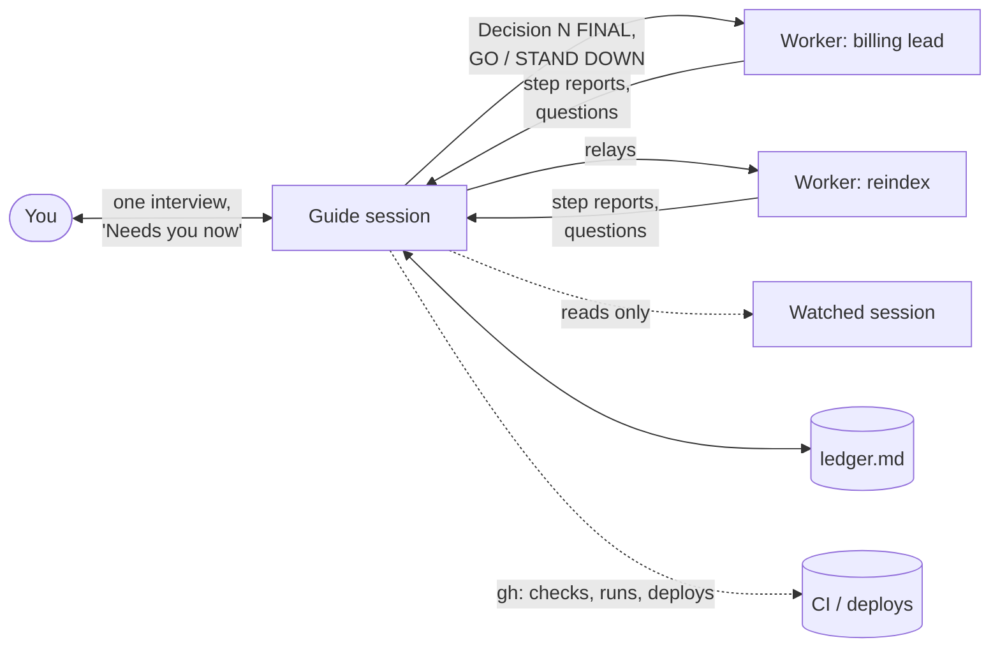

# How it works

## Roles

The guide never builds and never merges. Workers build. You decide and merge.

## A guide's turn

1. **Read the ledger.** It is the only state. Notes and status files are hints at best.
2. **Peek** at the 4–5 most active sessions (`peek.py`): last reply, any unanswered question, context size.
3. **Read CI**: PR checks, workflow runs, deploy jobs. One read per wake, never a watch loop.
4. **Reconcile.** Answer workers' questions from the Decisions list where possible. Batch the rest into one
   interview with you. Write the answers as numbered FINAL decisions and relay them, one message per worker.
5. **Reply** to you in the "Needs you now / Streams / Running on its own / Decision pending" shape.
6. **Update the ledger** in place and schedule the next wake: +5 for imminent events, +10 for long runs, backing off
   when only you can unblock things.

## Decisions

A decision is written once and relayed verbatim. If you contradict an earlier decision, the old line is struck
through, not deleted, so a fresh guide can see what changed. When you answer a worker directly, the guide adopts the
answer, and asks you which ruling stands if it conflicts with an earlier one, before anyone builds on it.

## Handoffs

Workers hand off near their context limit with a resume prompt. The guide starts the successor and records it as
MANAGED. The guide itself prints its context size in every status reply and hands off at 120k: because the ledger
is current, the next guide needs one line, `/session-guide` + "Take over as guide. Ledger: <path>."

The guide it replaces is **retired**, not left hanging. The new guide runs `guide_title.py retire <old id>`, so the old
title turns to "🟩🟩 Sessions Manager (retired) 🟩🟩" and never goes red again. Then it asks the old guide for a
final message ending in a `result:` line, which turns that session's state to done instead of "needs input". It
checks the state, and marks the old guide's row RETIRED in the ledger. An outgoing guide that sees its successor
introduce itself retires itself the same way.

## Guided prefix

A MANAGED worker's title starts with "(g) ", so the user can see which sessions don't need them. The marker is a
file next to the guide's own (`guides/<session id>`, holding `guided`), written by `guide_title.py guided`. On each
prompt the hook reads the session's current title and, when the prefix is missing, sets the same title with it in
front. When the prefix is already there it prints nothing, so a titling hook's focus update goes through untouched;
session-titles treats the one prefixed title as a rename and keeps "(g) " in its origin. `unguided` flips the marker
to `unguided`: the hook strips the prefix on the next prompt, then deletes the marker. Guide and retired markers hold
a ledger path or `retired`, so they never get the prefix.

## Sweeps and closing

Every wake starts with `claude-top --once -n 30`. A session active in the last 12 hours with no row in the ledger is
new: the guide writes the count into the ledger header (`New: <n>`, which its title shows) and asks about all of them
in one line, with a recommendation for each. A WATCHED session that asks a question gets it put to the user, and the
answer relayed back in one message, its only one.

A MANAGED session that is finished or obsolete is closed, the way a guide is retired: `guide_title.py done <id>`
writes the marker `done`, so the hook swaps "(g) " for "✅ " and never gives the session "(g) " or a guide title
again. The guide asks it for a final message with a `result:` line, checks its state shows done, and marks its row
DONE. A session stuck on a dialog can't read the message, so the user gets `! claude stop <id>` instead.

## Addressing sessions

Session titles change when sessions rename themselves. The guide replies to a worker's `from=` address when it has
one. Otherwise it re-reads `ListAgents` and uses the full current row name. Talking to you, it always uses the
title, with the short id in brackets.
